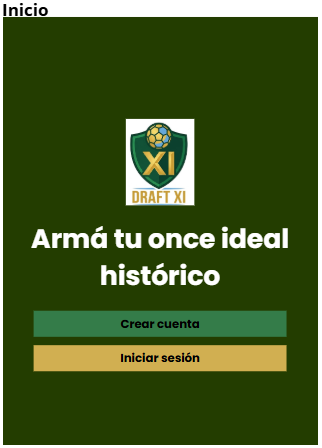
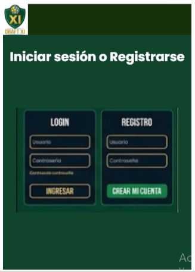
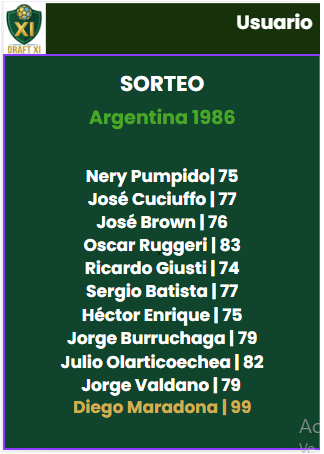
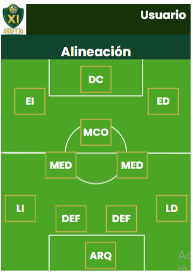
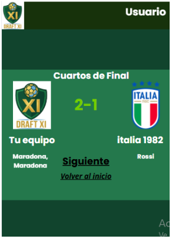
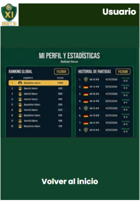
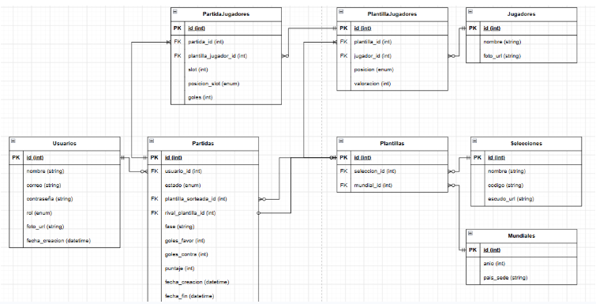

### Draft XI Mundial
#### Grupo [G19] · 2026-TPF-G19 · Integrantes: Bautista Marc, Facundo Nicolas Garcia, Agustin Medina Puchetta y Agustin Filipelli

## 1. Descripción del proyecto

#### Nombre: Draft XI Mundial 
#### Descripción general: aplicación web de fútbol donde cada usuario arma su once ideal con plantillas históricas de Copas del Mundo. En cada turno se sortea una selección y un año; el usuario elige un jugador para un puesto libre de su formación. Al completar los 11, el servidor simula el rendimiento del equipo y guarda un puntaje en un ranking.
#### Problemática: hay pocas propuestas para interactuar con la historia de los Mundiales de forma rápida.
#### Público objetivo: aficionados al fútbol, principalmente estudiantes, que quieran partidas cortas desde el celular o la computadora.
#### Objetivo general: desarrollar una aplicación web completa (frontend, backend y base de datos) para armar equipos mundialistas, simular su rendimiento y registrar resultados.
#### Funcionalidades principales: registro y login, roles (jugador y administrador), draft individual con simulación, historial y ranking y panel de administración.

## 2. Alcance

### Se desarrollará:
#### Registro e inicio de sesión (contraseñas, sesión) y roles jugador / admin, validados en el backend.
#### Draft individual: sortear selección y año, elegir jugador y completar el once.
#### Simulación del partido en el backend (ataque, defensa y azar) con resultado y puntaje.
#### Historial de partidas y ranking general.
#### Panel de administración con CRUD de selecciones, Mundiales, plantillas y jugadores.
#### Producto final: web responsive, identidad visual coherente, datos en MySQL, con una carga inicial de 22 selecciones, depende de la grandeza de la selección habrá más o menos mundiales y +300 jugadores.
#### Fuera del alcance: carga completa de todos los Mundiales, apuestas o dinero real, app móvil nativa y chat.

## 3. Diseño inicial

### Identidad visual: 
#### Elemento
#### Definición
#### Paleta
#### Verde cancha #0B3D2E, verde césped #1F8A4C, dorado #F5C542, celeste #75AADB, blanco hueso #F8F8F2, negro azulado #0E1A24, rojo error #E5484D
#### Tipografías
#### Bebas Neue (títulos y números), Poppins (texto)
#### Logo
#### Escudo con "XI" dorado y una pelota arriba, con "DRAFT XI" debajo. También una versión solo ícono para el favicon
#### Componentes
#### Botón principal verde (esquinas de 12 px), botón secundario con borde dorado, tarjetas en negro azulado con borde verde fino
#### Pantallas: inicio, registro/login, configuración de partida, tablero del draft, resultado, ranking e historial y panel de administración.

## 4. Modelo de datos

## 5. Planificación
### Tecnologías: React + Next.js · Node.js (Express) · MySQL · fetch (HTTP) · Socket.IO (WebSockets).
#### Objetivo
#### Tareas
#### Responsable
#### Fecha
#### Base del proyecto
#### Repo, estructura, .gitignore, ramas, DER y script.sql
#### Marc
#### 12/10
#### Diseño y servidor base
#### Paleta, servidor Express, Socket.IO y useSocket.js
#### Marc y García
#### 14/10
#### Usuarios y roles
#### Registro, login, middleware admin y usuario para docentes
#### García y Filipelli
#### 20/10
#### Datos y administración
#### Seed de datos y CRUD de selecciones, plantillas y jugadores
#### Medina y Marc
#### 23/10
#### Hito 1
#### Usuarios con roles, panel admin, datos cargados y sockets conectados
#### Todos
#### 23/10
#### Juego individual
#### Sorteo, tablero del draft y simulación
#### Medina
#### 30/10
#### Partidas y ranking
#### Guardado de partidas, historial y ranking
#### Filipelli
#### 06/11
#### Hito 2
#### Juego individual completo con guardado y ranking
#### Todos
#### 06/11

#### Cierre
#### Pruebas, DER y README actualizados y ensayo
#### Todos
#### 19/11

#### Trabajo en GitHub: cada tarea es un Issue asignado, se usan ramas y Pull Requests, y todos los integrantes hacen commits. No se suben credenciales ni node_modules.

